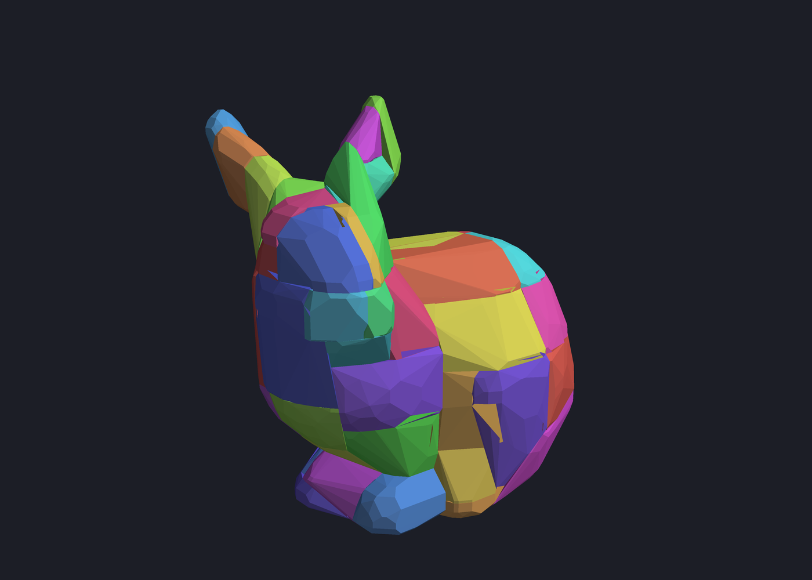
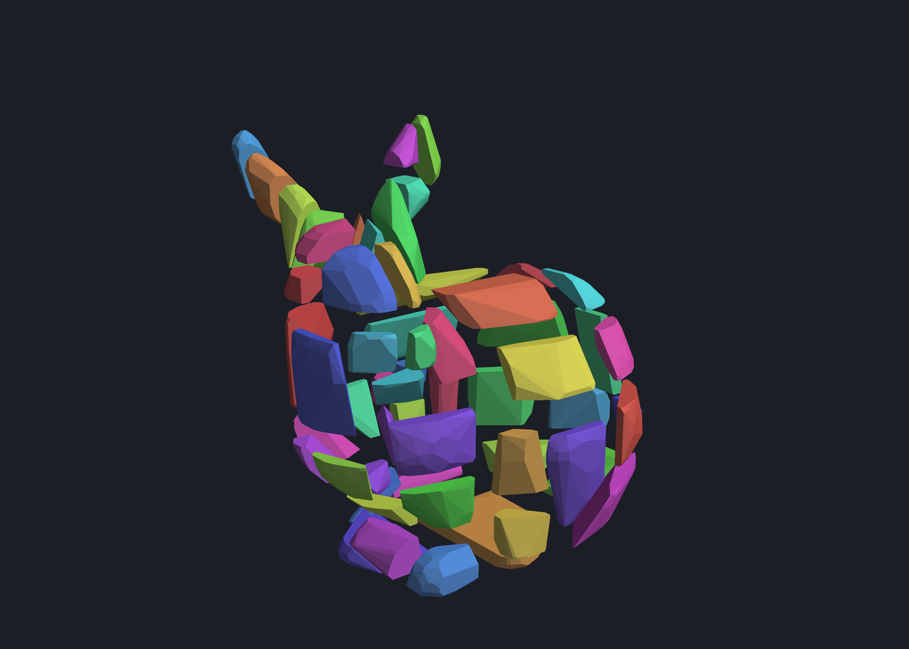
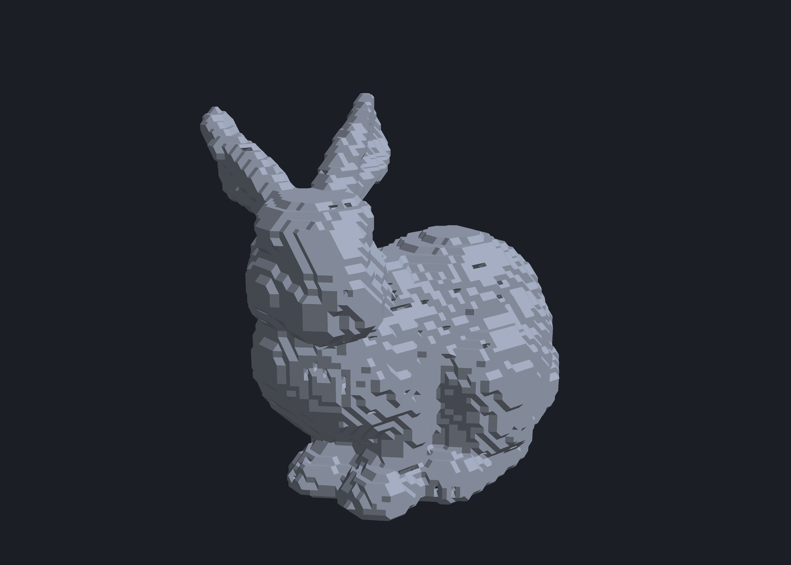
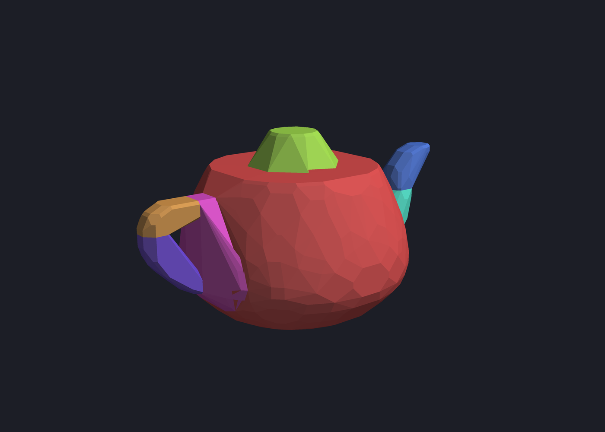
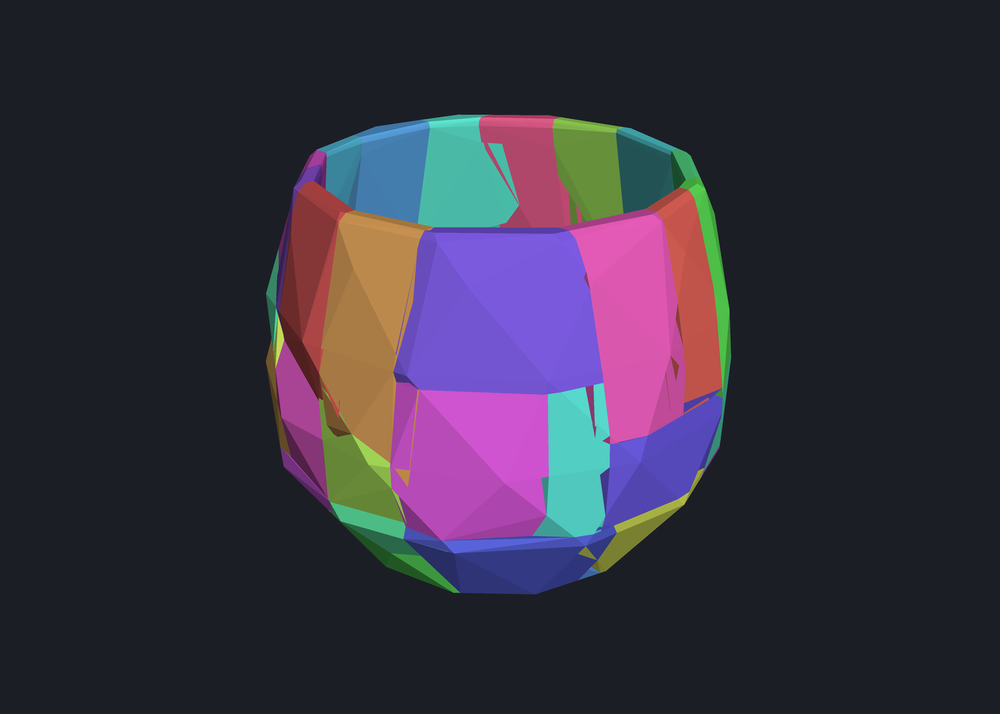

# cuacd-web

**Approximate convex decomposition on WebGPU, in the browser.**
A TypeScript + WGSL port of [CuACD](https://github.com/eliphatfs/cuacd)'s
GPU-resident lookahead decomposition (the [CoACD](https://github.com/SarahWeiii/CoACD)
formulation), with an interactive editor built on
[three.js](https://threejs.org) and [manifold-3d](https://www.npmjs.com/package/manifold-3d).

**[▶ Live demo](https://zalo.github.io/cuacd-web/)** (Chrome or Edge with WebGPU)



| exploded | input mesh (56k triangles, voxel remesh) |
|---|---|
|  |  |

| teapot, 7 parts | `49160.stl`, 47 parts |
|---|---|
|  |  |

Pictures: threshold 0.1, merging on; bunny 1.4 s, teapot 0.46 s, 49160 0.42 s
on an RTX 4090 under Deno.

## What it does

Given a closed triangle mesh, it finds a small set of convex pieces whose
union approximates the mesh within a concavity threshold, the way physics
engines and robotics pipelines want their collision shapes. The search is
CoACD's lookahead tree: at every iteration the most concave parts are cut by
the best plane found with a two-level lookahead over axis-aligned and
concave-edge candidate planes, and parts whose union stays convex enough are
merged back at the end.

Everything heavy runs on the GPU through WebGPU compute shaders:

- the lookahead tree (plane cuts, exact volumes, convex hulls of every
  candidate, level costs) and the plane refinement, in one submission per
  iteration;
- convex hulls with exact orientation predicates (grid quantization with a
  96-bit integer fallback), and branch-and-bound pruning at the last level;
- the Hausdorff distances that drive the stopping criterion and the merge pass.

The CPU side (TypeScript) caps the winning cuts, samples concave edges and
keeps the bookkeeping. In the demo all of that runs in a Web Worker that owns
the WebGPU device and streams granular progress to the page.

## The demo

```
deno task bundle && deno task serve      # http://localhost:8000/
```

- **Models**: the bunny (default), a voxel-remeshed teapot, a small STL from
  the CuACD test suite, a procedural staircase, or drop any OBJ / STL / PLY /
  GLB on the page.
- **Edit with manifold-3d**: pick a click tool (add, subtract or intersect a
  sphere, box or cylinder) and click the model; twist it; replace it with its
  hull; undo. Every edit returns a closed solid, and the decomposition re-runs.
- **Decompose**: threshold, lookahead width, concave-edge planes, refinement
  rounds, merging, cancel. The progress bar walks through the phases of every
  iteration (selection, tree search, cuts, hulls and Hausdorff) and the merge
  rounds; its fraction is estimated from the worst part's cost.
- **View**: hulls coloured by golden-ratio hue, part meshes or both, explode
  and opacity sliders, input wireframe overlay, a tooltip with each part's
  cost and volumes.

## Using the library

```ts
import { decompose, parseOBJ } from "./src/mod.ts";

const mesh = parseOBJ(await Deno.readTextFile("model.obj")); // closed mesh
const result = await decompose(mesh, { threshold: 0.1 });
for (const part of result.parts) {
  part.mesh; // { verts: Float32Array, tris: Uint32Array }, input units
  part.hull; // its convex hull, a clean closed mesh
}
```

Options mirror CuACD's `lookahead_decompose` and CLI: `threshold` (default
0.05, the CuACD default; the demo uses 0.1), `maxIters`, `width` (cuts per
level, multiple of 3), `width2`, `depth`, `maxNCutting`, `nConcaveEdges`,
`concaveEps`, `concaveThreshold`, `concaveIters`. Extras: `refineRounds` /
`refineProbes` (plane refinement), `mergeHulls` / `mergeRounds` (hull
merging, on by default), `signal` (an `AbortSignal`), `onProgress`,
`profile` (per-kernel GPU timings), `tree` (pool sizes). Input must be closed;
set `requireClosed: false` to try anyway. There is no voxel remeshing
preprocess yet: repair or remesh open meshes first (the demo's manifold tools
help, and `trimesh` voxel remeshing produced the sample models).

## Layout

```
src/mod.ts              public exports
src/decompose.ts        Decomposer: iteration loop, progress, abort, batching
src/merge.ts            hull-merging post-pass
src/part.ts             Part record and the rv / max(rv, Hausdorff) cost model
src/gpu/shaders.ts      WGSL kernels: plan, scan, emit, hull, evaluate, record
src/gpu/hausdorff_shader.ts  WGSL Hausdorff kernel
src/gpu/tree.ts         GpuTree: buffers, dispatch, readback
src/cpu/cut.ts          capped plane cut (Sutherland–Hodgman + earcut caps)
src/cpu/hull.ts         CPU hull backend (WASM quickhull), output hull cleanup
src/cpu/hausdorff.ts    CPU Hausdorff (reference)
src/cpu/concave.ts      concave-edge candidate planes
src/mesh.ts             mesh helpers, OBJ/STL parsing, normalization
wasm/                   Emscripten build of Antti Kuukka's quickhull (fallback)
demo/                   the browser app (main.js, worker.js, edit.js)
tests/                  Deno tests, Tint validation, benchmarks, page smoke test
docs/design.md          design decisions, pitfalls, the speed gaps that were closed
```

## Developing

```
deno task test                                   # 34 tests; needs a WebGPU adapter (Deno ships one)
deno task bench model.obj                        # profiled decomposition benchmark
deno run --allow-all tests/bench_hull.ts         # hull kernel throughput per phase
node --experimental-strip-types tests/validate_tint.mjs   # validate the WGSL with Dawn/Tint (Chrome's compiler)
deno task smoke                                  # boot the page in headless Chromium
deno task wasm                                   # rebuild wasm/qh.js (needs emsdk)
```

Deno's WGSL front end (wgpu) accepts code that Chrome's (Tint) rejects, so
run the Tint check after shader edits; it needs Dawn's `webgpu` npm package
(`DAWN_NODE_DIR`).

## Results against CuACD

RTX 4090, `width 30, nConcaveEdges 16, threshold 0.05`, merging on, Deno:

| Mesh | triangles | cuacd-web parts / time | CuACD (CUDA) parts / time |
|------|-----------|------------------------|---------------------------|
| 49160.stl | 552 | 142 / 0.77 s | 144–148 / 0.14 s |
| teapot (voxel R64) | 16.5k | 16 / 0.69 s | 24 / 0.29 s |
| bunny (voxel R64) | 56k | 246 / 2.3 s | 223–225 / 1.15 s |

Part counts vary run to run (the search is not bit-reproducible). About a
quarter of the Deno time is readback latency; Chrome's is lower.

## How it differs from CuACD

- Candidate parts in the tree are not capped: the volume of an uncapped half
  is recovered exactly from its open boundary loops, so the 1.5k-line cap
  triangulation only runs on the CPU for the winning cut.
- The hull is an incremental quickhull per workgroup with exact predicates
  (each part on a 2^21 grid, f32 test with a rigorous error bound, 96-bit
  integer determinant otherwise) instead of CuACD's exact-arithmetic
  divide-and-conquer hull. Output hulls are rebuilt in double precision from
  the exact hull's vertices so they carry no needle faces.
- Plane refinement (CoACD's ternary search) is included; CuACD has none.
- Hull merging repeats the greedy matching until nothing qualifies, where
  CuACD runs one round.
- A GPU `evaluate` kernel picks the cuts, so an iteration costs two GPU round
  trips instead of ten.
- Not ported: PaMO voxel preprocessing, connected-components splitting,
  `quick_depth`.

`docs/design.md` has the details, the pitfalls, and the performance work.

## Credits and licence

Port of [CuACD](https://github.com/eliphatfs/cuacd) (LGPL-2.1), which
implements [CoACD](https://github.com/SarahWeiii/CoACD) (Wei et al., SIGGRAPH
2022) on CUDA. The CPU hull fallback is Antti Kuukka's public-domain
[quickhull](https://github.com/akuukka/quickhull). Mesh editing uses
[manifold-3d](https://github.com/elalish/manifold) (Apache-2.0); rendering
uses [three.js](https://threejs.org) (MIT). The demo's structure follows
[StochasticLatticeGen](https://github.com/zalo/StochasticLatticeGen).

This repository is licensed under the GNU Lesser General Public License v2.1,
the licence of the CUDA implementation it ports.
